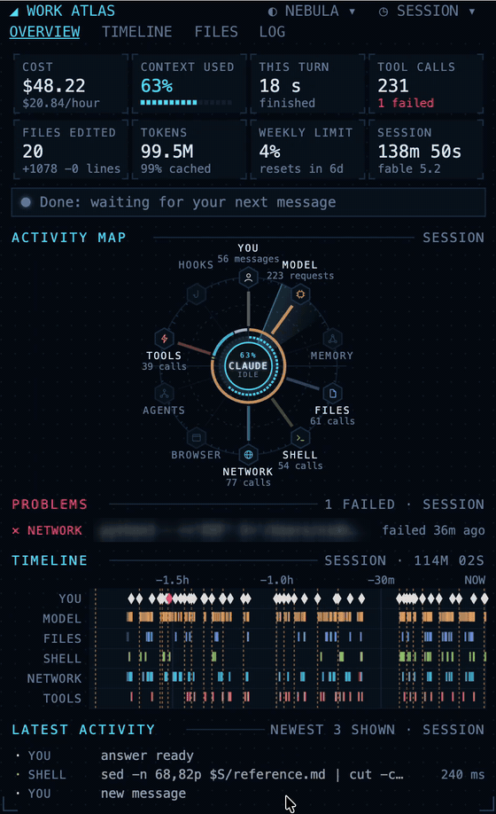

# Work Atlas

A mod for Claude Code that puts a live dashboard of the session in a pane beside the chat: what Claude is doing right now, what it has cost, where the time went, which files it touched and what failed.



## Install

Run this in your system terminal (Terminal, iTerm, PowerShell), not inside Claude:

```bash
claude plugin install work-atlas --marketplace nidhinradh/work-atlas --scope user
```

That installs it for every project and every session, including the Claude desktop app. Start a new session to see it.

**If you are in the Claude desktop app:** typing `/plugin install …` there does not work. It opens the Plugins page, which lists only the official directory. Use the terminal command above. Once installed that way, Work Atlas loads in the desktop app too.

**If you are in a Claude Code terminal session** (the `claude` command-line app), you can install from its prompt instead:

```
/plugin install work-atlas --marketplace nidhinradh/work-atlas
```

Confirm adding the marketplace with `y`, then pick the **user** scope.

Work Atlas opens its pane automatically at the start of each session. If you close the pane, `/work-atlas` brings it back.

To update later:

```bash
claude plugin marketplace update work-atlas
```

```bash
claude plugin update work-atlas@work-atlas
```

To remove it:

```bash
claude plugin uninstall work-atlas@work-atlas
```

## What it shows

Eight figures stay at the top of every tab. They are always totals for the session.

| Figure | What it tells you |
| --- | --- |
| Cost | What the session has cost so far, and the rate per hour |
| Context used | How full the context window is. Amber from 70%, red from 90% |
| This turn | How long the current turn has run, and which step it is on |
| Tool calls | How many tools were called, and how many failed |
| Files edited | How many files were changed, and the lines added and removed |
| Tokens | Tokens used, and the share served from the cache |
| Usage limit | How much of your 5-hour or weekly limit is used, and when it resets. Shown when your account reports one; otherwise the model |
| Session | How long the session has run |

Under them, one line says what is happening now: `Running shell: npm test`, `Claude is thinking`, `Waiting for your answer`.

### Overview

Everything at a glance, as much as the pane has room for.

- **Activity map.** Claude in the centre, one station for each kind of work: you, the model, memory, files, shell, network, browser, subagents, other tools, and settings hooks. A pulse runs to a station while a call is running. A spoke thickens the more its station is used. A red badge counts failures.
- **Problems.** The calls that failed or were blocked, newest first. Shown only when there are some.
- **Timeline.** One lane per kind of work, a bar for every call, and under it how many calls were running at once.
- **Where the time went.** One bar split between the model thinking, each kind of tool, waiting on you, and nothing running.
- **Activity by type.** Calls, failures, total time, average and slowest call for each kind of work.
- **Subagents.** The ones currently running: their task, latest call, number of calls and running time.
- **What fills the context.** The context window by category, as `/context` estimates it.
- **Files touched** and **Latest activity**, where there is room.

### Timeline

Why a turn was slow: taller lanes, the calls running at once, where the time went, and the slowest calls.

### Files

What Claude touched: for each file, how many times it was edited and read, the lines changed, when it was last touched, and whether a call on it failed. Below, the busiest folders.

### Log

What happened, in order: when, what kind, what, and how long it took. On this tab the toolbar adds a chip for each kind of work; click one to see only its calls.

## The time window

The dropdown at the top right sets the window: **This turn**, **Last 5 min**, or **Session**. Every section under the eight figures follows it, and each section's heading says which window it is showing.

The figures are of the whole of what they name:

- Every call of the current turn and of the last five minutes is kept, so those windows are exact.
- Session totals are added up as each call ends. They do not depend on how many calls are still held in memory.
- A call that is no longer held one by one is folded into a compact record of how busy each stretch of the session was, so the Session timeline still draws the whole session. In that older stretch a bar shows that a kind of work was busy, not each single call.

## Themes

The second dropdown picks the look: **Nebula** (deep navy, cyan and glow, the default), **Dark** (neutral greys) or **Light** (paper and ink). Your choice, and your window, are remembered across sessions.

## Commands

| Command | What it does |
| --- | --- |
| `/work-atlas` | Opens the pane |
| `/work-atlas summary` | Prints a five-line summary of the session in the chat |
| `/work-atlas theme dark` | Switches the theme: `nebula`, `dark` or `light` |

With the toolbar focused (click it), `1` to `4` switch tabs.

## Options

Set on the install screen, or later with `claude plugin configure work-atlas`.

| Option | Default | Meaning |
| --- | --- | --- |
| `theme` | `nebula` | The look the pane starts in, until you pick one in the pane |
| `alerts` | `true` | A short notice, once each, when the context passes 85% full or a usage limit passes 90% |
| `coreName` | `CLAUDE` | Text in the middle of the activity map (max 10 characters) |
| `memoryServers` | `memory` | Names of MCP servers that provide memory; their calls are counted as Memory |
| `cellShape` | `2.25` | How many times taller a row of the pane is than a column is wide. Raise it if the drawing leaves an empty band at the bottom; lower it if the pane scrolls |

## Where it runs

| Surface | What you get |
| --- | --- |
| Claude desktop app | Everything: the drawn dashboard, and a toolbar drawn to match it |
| VS Code extension | The drawn dashboard, with the app's own buttons for the tabs and the window |
| Terminal | Text only: the figures, a timeline in block characters, and the log |

Developed against Claude Code 2.1.321 on macOS. Other platforms are untested.

## What it reads, and what it keeps

Work Atlas only watches. It never blocks, changes or delays a tool call, a prompt or a turn, and a fault of its own cannot fail one.

- It keeps **names, not contents**: file paths, the first line of a shell command (or its description), the host of a URL, a search query, a tool's name. It never keeps what a file holds or what a tool returned.
- It keeps this **in the session's own state**, on your machine. Nothing is sent anywhere.
- Across sessions it remembers two things: your theme and your window.

Shell commands can contain things you would not want on screen. If you share your screen or record it, the Log tab and the Problems section are where they show.

## How it is built

A mod is a plugin whose hooks are a TypeScript module. This one is in `hooks/`:

| File | What it does |
| --- | --- |
| `register.tsx` | Listens to the session's events and draws the pane |
| `ledger.ts` | The bookkeeping: what the board looks like after each event |
| `tally.ts` | What is kept and what is added up, so every figure is of the whole of what it names |
| `classify.ts` | Which kind of work a tool call is, and what to call it |
| `time.ts` | Where a stretch of time went |
| `hud.ts` | The drawing, laid out to fill whatever size the pane is |
| `toolbar.tsx`, `toolbar-layout.ts` | The toolbar the desktop app draws, and where each word of it goes |
| `palette.ts` | The three themes |
| `atlas.test.tsx` | The tests |

To work on it:

```bash
claude --plugin-dir . 
```

```bash
claude plugin validate .
```

```bash
claude plugin test .
```

## Licence

[MIT](LICENSE)
